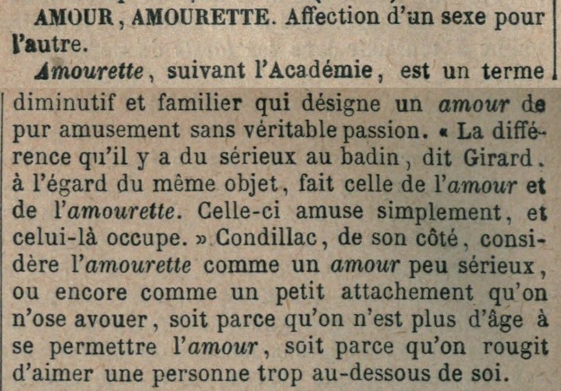
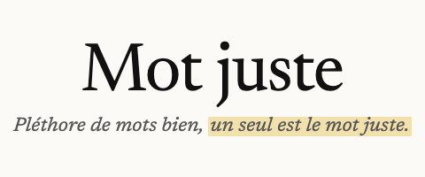

# Dictionnaire des synonymes de Lafaye

Le *Dictionnaire des synonymes de la langue française* de Pierre-Benjamin Lafaye (9e édition, avec
le Supplément) en jeu de données : pour chaque groupe de synonymes, ce que les mots ont en commun,
ce qui les distingue, et les citations d'auteurs qui le montrent. Il se lit en ligne dans la section
[Différence entre synonymes](https://motjuste.fr/difference) de MotJuste.



*Page 220 de l'exemplaire numérisé : l'article commence au bas d'une colonne et finit en haut de la
suivante. Le même article, en données, est donné plus bas.*

| | |
| --- | --- |
| Entrées | 2 703 : 2 409 articles et 294 chapitres |
| Texte | environ 1,37 million de mots |
| Citations attribuées | 15 829, de 76 auteurs (Voltaire, Bossuet, Rousseau, Rollin, Fénelon…) |
| Notes de bas de page | 114 |
| Fichier | `data/lafaye.jsonl`, une entrée par ligne |

## Exemple

L'article « Amour, amourette » :

```json
{
  "id": "amour",
  "type": "article",
  "section": "partie-1",
  "chapitre": "TERMINAISON ETTE",
  "page": 220,
  "page_scan": 314,
  "vedette": "AMOUR, AMOURETTE",
  "termes": ["amour", "amourette"],
  "idee_commune": "Affection d’un sexe pour l’autre.",
  "paragraphes": [
    "*Amourette*, suivant l’Académie, est un terme diminutif et familier qui désigne un *amour* de pur amusement sans véritable passion. « La différence qu’il y a du sérieux au badin, dit Girard, à l’égard du même objet, fait celle de *l’amour* et de *l’amourette.* Celle-ci amuse simplement, et celui-là occupe. » Condillac, de son côté, considère *l’amourette* comme un *amour* peu sérieux, ou encore comme un petit attachement qu’on n’ose avouer, soit parce qu’on n’est plus d’âge à se permettre *l’amour,* soit parce qu’on rougit d’aimer une personne trop au-dessous de soi."
  ],
  "notes": [],
  "citations": []
}
```

## Champs

| Champ | Contenu |
| --- | --- |
| `id` | Identifiant de l'entrée, tiré de son premier terme (`amour`) ou du titre du chapitre (`prefixe-re`). |
| `type` | `article` ou `chapitre`. |
| `section` | `partie-1` (synonymes de même radical), `partie-2` (synonymes à radicaux divers) ou `supplement`. |
| `chapitre` | Première partie : titre du chapitre où se range l'article. `null` ailleurs. |
| `page` | Page imprimée où l'entrée commence. |
| `page_scan` | Numéro de l'image correspondante dans la numérisation. |
| `vedette` | La vedette telle qu'imprimée, en capitales ; pour un chapitre, son titre. |
| `termes` | Les synonymes comparés, en minuscules. |
| `idee_commune` | Ce que les synonymes ont en commun : la phrase qui suit la vedette. |
| `paragraphes` | Le corps de l'entrée. L'italique est rendu par des astérisques. |
| `citations` | Citations entre guillemets suivies d'un sigle d'auteur : `texte`, `sigle`, `auteur`. |
| `notes` | Notes de bas de page : `appel` (numéro), `page_scan`, `texte`. |
| `exemples` | Chapitres seulement : les groupes de mots que le chapitre traite en bloc. |

## Méthode et limites

Texte établi d'après l'exemplaire numérisé par Internet Archive
([dictionnairedess00lafauoft](https://archive.org/details/dictionnairedess00lafauoft)) : deux
reconnaissances de caractères fusionnées, puis chaque ligne relue contre l'image de la page par un
modèle de vision. Les entrées ont été confrontées à la table alphabétique du livre : 98,8 % des
groupes de la deuxième partie s'y retrouvent, et tous ceux du Supplément.

L'orthographe est celle de l'époque (« piége », « très-nutritif »). Seules les fautes d'impression
qui donnent un mot inexistant sont corrigées.

Limites :

- il reste des erreurs de lecture, et le grec n'a pas été vérifié ;
- les citations en vers sont rendues à la suite, sans retour à la ligne ;
- `citations` ne contient que les citations entre guillemets suivies d'un sigle d'auteur reconnu ;
- l'introduction du livre et ses tables ne sont pas dans le jeu de données.

## Licence

Le texte de Lafaye est dans le domaine public. Le travail d'édition qui en fait un jeu de données
est publié sous licence [CC BY 4.0](https://creativecommons.org/licenses/by/4.0/deed.fr). Mention à
reprendre :

> Ghiles Meddour, motjuste.fr (https://motjuste.fr), d'après le Dictionnaire des synonymes de la
> langue française de Lafaye. Licence CC BY 4.0.

## Où le lire

Ce jeu de données alimente la section
[« Différence entre synonymes »](https://motjuste.fr/difference) de MotJuste, où chaque groupe de
synonymes a sa page.

<a href="https://motjuste.fr/difference" target="_blank" title="Mot juste : dictionnaire de rimes, de synonymes et de conjugaison"></a>
